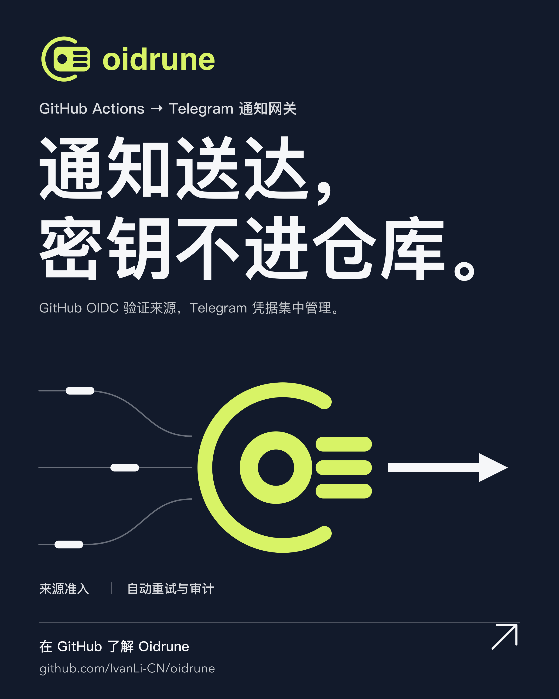
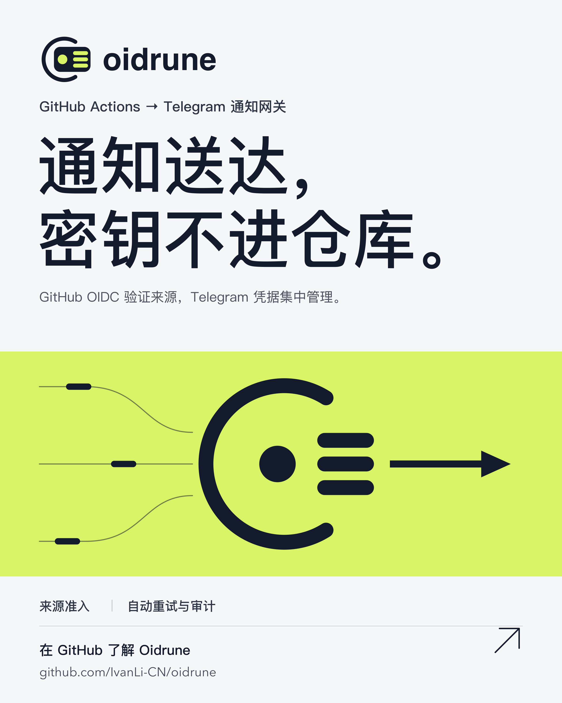

# Oidrune

[English](./README.md) | 简体中文

Oidrune 是一个托管在 Cloudflare 上的 GitHub Actions 通知网关。它只接受来自已批准所有者或仓库、经过 GitHub 签名的 OIDC 令牌，然后将结构化的工作流完成通知异步发送到由运营者控制的一个 Telegram 目的地。

使用 Oidrune 的 GitHub 项目不保存 Telegram token、webhook secret、目的地标识符或 Oidrune 凭据。调用方只需要调用 Oidrune 固定版本的可复用工作流，并授予范围收窄的 `id-token: write` 权限。

## MVP

- 面向 `workflow.completed` 事件的公开 OIDC 认证入口。
- 一个由运营者选择的 Telegram 私聊、群组或频道。
- 所有者/仓库联合准入列表、可信工作流发布 SHA 策略，以及 GitHub 托管 runner 要求。
- 持久化接收、自动 Telegram 重试、死信队列和运营者控制台。
- 通过 Cloudflare Access 使用 GitHub 登录，保护控制台和管理员 API。

每个部署都会暴露一个由运营者配置的 Public Protocol Endpoint。公开 OIDC 入口仍位于 `/v1/events/workflow-completed`；Cloudflare Access 只保护 `/console*` 和 `/api/admin*` 路径。

## 项目事实

- [产品范围](./PRODUCT.md)
- [领域语言](./CONTEXT.md)
- [决策备忘录](./docs/decision-memo.md)
- [MVP 规格](./docs/specs/oidrune-mvp/SPEC.md)
- [质量门禁契约](./docs/quality-gates.md)

## 本地开发

Oidrune 是一个 Bun 单包项目。使用 `bun install` 安装依赖，然后使用 `bun run dev` 启动同源控制台，使用 `bun run quality` 执行本地质量聚合，或使用 `check`、`typecheck`、`test:unit`、`test:integration` 和 `test:e2e` 脚本执行专项检查。控制台演示是确定性的，不会调用 Cloudflare Access、D1、Queues 或 Telegram。

专用 Cloudflare D1、队列、Public Protocol Endpoint、GitHub-backed Access 应用和 Worker Secrets 只应在单独授权的部署阶段配置。Fork Deployment 可以使用 `workers.dev` 开始；生产环境建议使用 Custom Domains。`wrangler.jsonc` 声明部署所需的 Cloudflare bindings；目的地元数据和 Access 运行时值保留在源码树之外。GitHub 运营者身份、OAuth 配置、Access 身份提供商详情和策略值也不得提交到仓库。

## 生产冒烟测试

`Oidrune smoke` 工作流是一个永久保留的手动端到端检查。从 `main` 分支打开 GitHub Actions，选择 `Oidrune smoke`，然后选择 **Run workflow**。它会通过 GitHub OIDC 调用 SHA 固定的 `notify.yml` 发布工作流，要求公开网关返回 `202`，并在网关移交耗尽时使通知任务失败。接收成功的事件会为配置的 Telegram 目的地排队一次通知尝试；投递还需要 Worker 中单独管理的 Telegram secret。调用方不需要任何 secret。调用方提供的 `summary` 会作为完整的 Telegram 正文；Oidrune 只做规范化，不添加工作流元数据。后续验证任务会查询对应的 D1 事件，并在 Queue consumer 没有为该调用方正文记录 `delivered` 时失败。

## 品牌素材

中文 GitHub social preview（1280 × 640）：[深色 PNG](./docs/marketing/social-preview/oidrune-social-preview-dark.png) · [亮色 PNG](./docs/marketing/social-preview/oidrune-social-preview-light.png)。

中文产品海报（4:5，2400 × 3000）：

| 深色 | 亮色 |
| --- | --- |
|  |  |

英文素材：[social preview 深色版](./docs/marketing/social-preview/oidrune-social-preview-dark-en.png) · [social preview 亮色版](./docs/marketing/social-preview/oidrune-social-preview-light-en.png) · [深色海报](./docs/marketing/posters/oidrune-poster-dark-en.png) · [亮色海报](./docs/marketing/posters/oidrune-poster-light-en.png)。

## License

MIT。
